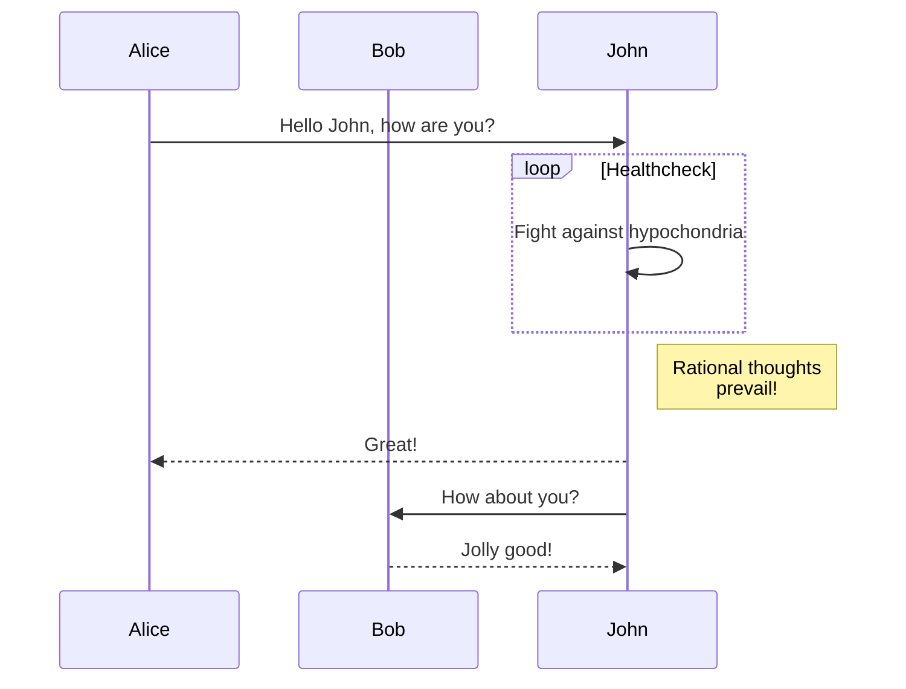

Software engineers build solutions to problems using software. We start with some abstract behaviour that we want our 
software to be able to provide. Then, consciously or not, we iteratively break this down until we reach a set of concrete 
implementation details that collectively provide the behaviour - a floor of concreteness.

For example, we might want to 'allow people to transfer money to anyone in the world'. The tree diagram below shows how 
we might implement this behaviour:

-- tree consisting of high level intent at the top and low level mechanics at the bottom --

When building a solution for a problem, we iteratively break down high level intent to low level 

with some high level notion of intent and iteratively break

audience: software engineers

high-level intent vs low-level implementation

a behaviour at level N should be composed of behaviours implemented at level N-1

use interfaces and function to create 'boundaries of abstraction'

situation: we start with a problem that we have an abstract notion of what a solution looks like. we then
break down each step further and further until we reach a floor of concreteness. then we begin implementing

we go through a journey breaking down high level intent to low level implementation

-- some tree of high level intent down to low level implementation

but when it comes to implementing we do two things wrong:

1. we just implement the leaf nodes of the tree in a single function that is labelled with the high level intent
2. we mix levels in the same function

complication: we end up mixing steps that exist and different abstract levels or making large jumps between levels of abstraction
which makes code hard to read and understand

question: how can we translate those steps to code whilst still being easy to read and understand and faithful to how we 
got to the solution?

answer: software should be written at a single level of abstraction

key argument 1: mixing levels of abstraction or flattening imposes a cognitive cost 

key argument 2: we should enforce SLAP through behavioural contracts

key argument 3: this pushes concreteness down the stack so that we only concern ourselves with what is most important at each level of our code (the essence) 

